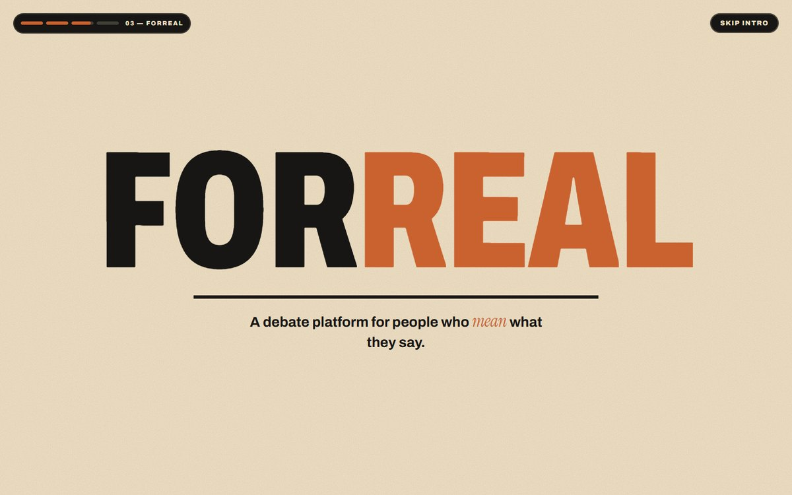
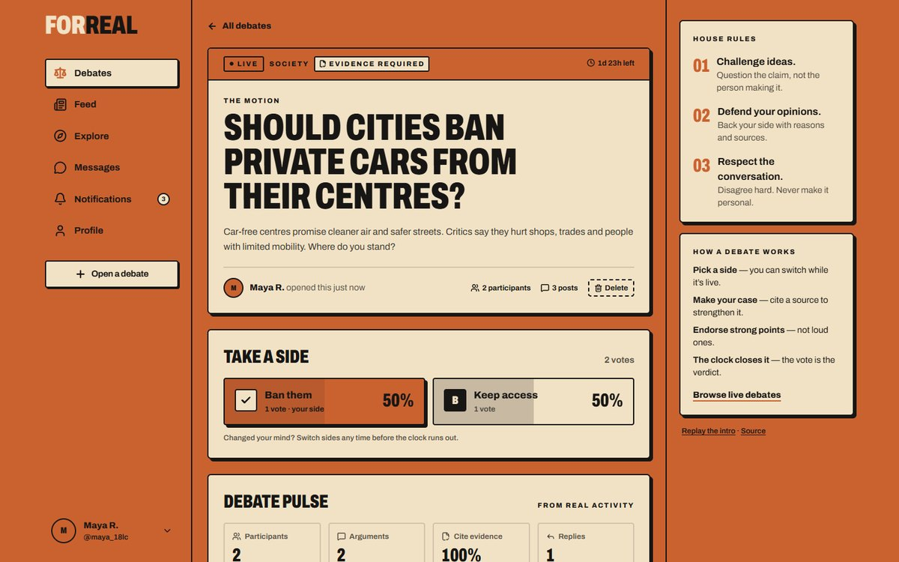
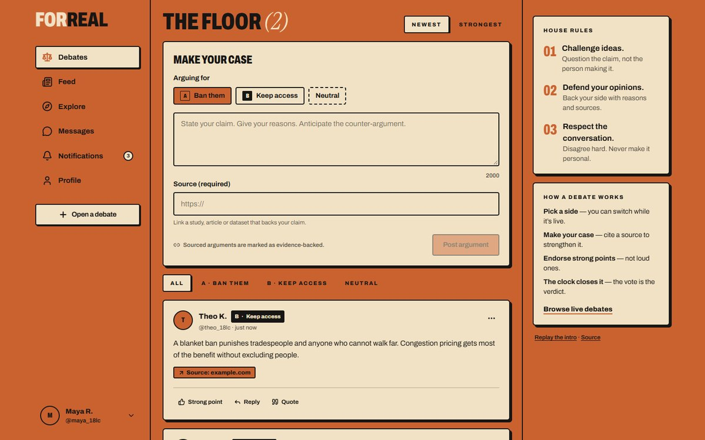
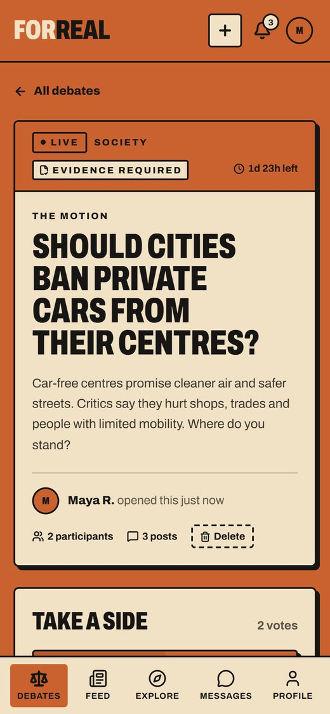
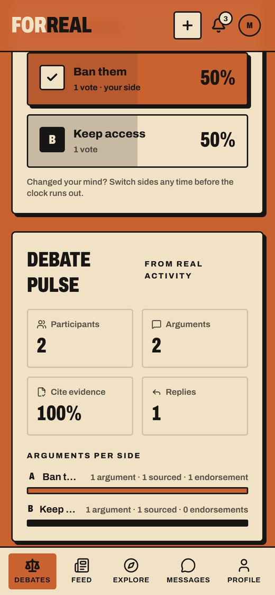

# ForReal

**Don’t just post it. Defend it.**

ForReal is a debate platform for meaningful conversation. Social feeds reward whoever is loudest; ForReal rewards whoever makes the better case. Members open a question, pick a side, back their argument with evidence, and let the community’s vote decide when the clock runs out.

> Challenge ideas. Defend your opinions. Respect the conversation.



---

## What it does

### Debates — the core of the product
- **Open a motion** with 2–4 sides, a category and a timer (1 hour to 1 week).
- **Evidence-required mode**: the creator can require every top-level argument to include a source link.
- **Vote and switch**: members take a side and can change it while the debate is live. Vote counts update atomically and in real time for everyone in the room.
- **The floor**: arguments are labelled with the side they support, can cite a source, and can be filtered by side and sorted by *Newest* or *Strongest*.
- **Endorse strong points** (not your own), **reply**, and **quote** an argument to rebut it directly.
- **Debate pulse**: real, aggregated statistics — participants, arguments per side, share of evidence-backed arguments, replies and endorsements.
- **A final record**: when the timer ends the debate closes automatically, the vote becomes the verdict (ties are reported honestly), the floor becomes read-only, and the creator is notified.
- Live updates over WebSockets: new arguments, replies, vote shifts and “drafting an argument…” typing indicators.

### Around the debates
- **Feed** — short “talks” with images, Agree/Disagree/Like/Dislike reactions, comments, bookmarks, hashtags, safe auto-linked URLs and shareable talk pages.
- **Explore** — search across debates, people and talks; hashtags link straight into search.
- **Messages** — real-time direct messages with unread counts and typing indicators.
- **Notifications** — follows, comments, replies, endorsements, reactions and debate verdicts, delivered live with an unread badge.
- **Profiles** — follow/unfollow, and tabs for a member’s debates, arguments and talks.
- **Cinematic introduction** — a five-scene story (the noise → question everything → ForReal → ideas collide → the invitation) that explains the product to first-time visitors.

| | |
|---|---|
|  |  |
|  |  |
|  |  |

<p align="center">
  
  &nbsp;&nbsp;
  
</p>

---

## Design system: three colours, nothing else

The entire interface — including focus rings, toasts, charts, badges and the intro — uses exactly three colours plus opacity variants of them.

| Token | Hex | Role |
|---|---|---|
| `ember` (burnt orange) | `#CA6230` | ~60% · brand surfaces, selection, emphasis |
| `ivory` (warm ivory) | `#F2E2C5` | ~30% · reading surfaces, cards, forms |
| `ink` (soft black) | `#171614` | ~10% · text, rules, dark accents |

- **Single source of truth:** `client/src/index.css` defines the tokens and *removes Tailwind’s default palette*, so classes like `bg-blue-500` or `text-white` generate no CSS at all.
- **Accessible by measurement:** the orange was tuned from `#C65D2E` to `#CA6230` so ink text on orange passes WCAG AA (4.56:1). Ink on ivory is 14.2:1. The ivory is a deliberately warm cream (`#F2E2C5`) so it never reads as white. Ivory on orange is reserved for large display type.
- **Status without extra hues:** errors use dashed borders, an icon and text; debate sides are distinguished by solid and hatched tones plus letter labels.
- **Typography:** Archivo (variable width/weight) for UI and condensed display type; Instrument Serif italic for editorial accents.
- `prefers-reduced-motion` is respected everywhere; reduced-motion visitors see the static landing page instead of the intro.

---

## Architecture

```
client/  React 19 · Vite · Tailwind CSS v4 · React Router 7 · Zustand · Socket.IO client
server/  Node.js · Express 5 · MongoDB (Mongoose 9) · Socket.IO · JWT · Winston
```

```
Browser ──HTTPS──▶ Express API ──▶ MongoDB
   ▲                  │
   └──── WebSocket ◀──┘  (debate rooms, private user rooms, conversations)
```

- `server/app.js` builds the Express app (testable without a network port); `server/server.js` owns the process lifecycle — DB connection with retries, Socket.IO, a debate-lifecycle scheduler and graceful shutdown.
- `server/services/debateLifecycle.js` closes expired debates idempotently and flags debates that are ending soon.
- `client/src/pages` are route-level, lazily loaded chunks; shared primitives live in `client/src/components/ui`.

### Engineering highlights

**Authentication**
- Short-lived access tokens (15 min) kept in memory; rotating refresh tokens in an `httpOnly` cookie scoped to `/api/auth`.
- Refreshes are single-flight on the client, and the server allows a 60-second grace window for the previous token, so parallel requests and multiple tabs never sign each other out.
- Changing a password requires the current password.

**Security**
- Helmet, a CORS allow-list (including the project’s own Vercel preview URLs), global and credential-specific rate limits, and `trust proxy` for correct client IPs behind a PaaS.
- NoSQL-injection sanitiser compatible with Express 5; search input is regex-escaped; evidence links accept only `http(s)` URLs.
- Socket rooms are authorised from the verified token — a client cannot join another user’s private room or a conversation it is not part of.
- Uploads are validated by MIME type with server-generated filenames; user content is always rendered as text.
- Public profiles and author payloads never include email addresses or password hashes.

**Data integrity and performance**
- Vote, reaction, bookmark, endorsement and comment counters use atomic `$inc` updates (no read-modify-write races).
- The viewer’s own reactions, bookmarks and endorsements are attached with batched `$in` queries instead of one query per item.
- Cursor pagination for feeds and messages; indexes for timelines, debate lists and arguments.
- The client is split per route. Socket.IO loads only after sign-in, and the animation library loads only while the intro plays. Initial JavaScript is ~112 KB gzipped (down from a single 197 KB bundle).

---

## Getting started

**Requirements:** Node.js 20+ and a MongoDB connection string (local or Atlas).

```bash
git clone https://github.com/shanmukha1013/ForReal.git
cd ForReal

# API
cd server
cp .env.example .env        # then fill in MONGODB_URI and JWT_SECRET
npm install
npm run dev                 # http://localhost:5000  (health: /api/health)

# Web app (second terminal)
cd client
npm install
npm run dev                 # http://localhost:5173
```

### Environment variables

`server/.env` (see `server/.env.example`)

| Variable | Required | Description |
|---|---|---|
| `MONGODB_URI` | yes | MongoDB connection string |
| `JWT_SECRET` | yes | Long random string used to sign access tokens |
| `CLIENT_URL` | yes | Allowed browser origin(s), comma-separated |
| `JWT_REFRESH_SECRET` | no | Defaults to a value derived from `JWT_SECRET` |
| `PORT`, `NODE_ENV` | no | Default `5000` / `development` |

`client/.env` (see `client/.env.example`)

| Variable | Description |
|---|---|
| `VITE_API_URL` | API base URL, e.g. `http://localhost:5000/api` |
| `VITE_SOCKET_URL` | Socket/asset origin, e.g. `http://localhost:5000` |

---

## Scripts and quality checks

| Where | Command | What it does |
|---|---|---|
| `server/` | `npm test` | 20 API integration tests against an in-memory MongoDB (auth and session rotation, injection attempts, CORS, profiles, feed, debates, lifecycle, messaging) |
| `server/` | `npm run dev` / `npm start` | Development (nodemon) / production server |
| `client/` | `npm run lint` | oxlint |
| `client/` | `npm run build` | Production build |

CI (`.github/workflows/ci.yml`) installs both packages, audits server dependencies, runs the API tests, lints and builds the client.

---

## Deployment notes

- **API** (e.g. Render): set the environment variables above; `NODE_ENV=production` enables secure, cross-site refresh cookies. Health check path: `/api/health`.
- **Web app** (e.g. Vercel): set `VITE_API_URL` and `VITE_SOCKET_URL` to the API origin. `client/vercel.json` provides SPA rewrites and long-term caching for hashed assets.
- Uploaded images are stored on the API server’s disk. On hosts with ephemeral filesystems (such as Render’s free tier) they are lost on redeploy; production use should move uploads to object storage.

---

## Project structure

```
client/src/
  components/ui      design-system primitives (Button, Field, Modal, Avatar, …)
  components/feed    talks: composer, card, reactions, comments
  components/intro   the cinematic introduction
  features/debates   debate card, voting, pulse/verdict, argument floor
  pages              route-level screens (lazy-loaded)
  services, store, hooks, lib
server/
  controllers, routes, models, middleware
  services           debate lifecycle, notifications
  sockets            authenticated Socket.IO rooms
  tests              API integration tests
```
